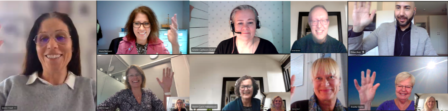

## Nu finns vi på den polska marknaden!

Vi är glada och stolta över att presentera vårt samarbete med [Kamila Majchrzak](https://www.linkedin.com/in/kamilamajchrzak/) och [Business Match Scandinavia & Poland](https://www.linkedin.com/company/business-match-scandinavia-poland/). Vi kom i kontakt med Kamila under våren 2020 och har sedan dess arbetat hårt med att översätta hela PulsAnalys-systemet till polska.

Nu kan vi utöka verksamheten till Polen och sprida kunskap om PulsAnalys DISC på den polska marknaden. Det ger också våra befintliga kunder möjlighet att utbilda sina polska kollegor i DISC och använda systemet fullt ut på polska. Vi startar expansionen genom att utbilda de första PulsAnalys DISC-användarna och distributörerna i maj 2021.

> ”Jag ser fram emot samarbetet mellan det polska teamet och vår mentor Mia Wernersson från Sverige och hennes underbara team och är säker på att vårt arbete kommer att ske på professionell nivå i vårt affärssamarbete.” – Kamila Majchrzak, Business Relationship Manager på Business Match Scandinavia & Poland

## Grattis till våra nycertifierade PulsAnalys-användare!

- Anna-Carin Håkansson – [Anna-Carins LinkedIn](https://www.linkedin.com/in/anna-carin-h%C3%A5kansson-32953120/)
- Emma Rejdvik – [Emmas LinkedIn](https://www.linkedin.com/in/emma-rejdvik-b2b2355a/)
- Göran Burman – [Görans LinkedIn](https://www.linkedin.com/in/g%C3%B6ran-burman-4a348416/)
- Maria Blomdahl – [Marias LinkedIn](https://www.linkedin.com/in/maria-blomdahl-a3587a9/)
- Kristin Carlsson – [Kristins LinkedIn](https://www.linkedin.com/in/kristin-carlsson/)
- Jessica Frösell – [Jessicas LinkedIn](https://www.linkedin.com/in/jessica-fr%C3%B6sell-8ab1852b/)
- Dilan Aziz – [Dilans LinkedIn](https://www.linkedin.com/in/a-dilan-aziz-b913bb171/)
- Anette Stoltz – [Anettes LinkedIn](https://www.linkedin.com/in/anette-stoltz/)

## Tack, Daniel!

Vi vill tacka Daniel Lundell för ett fint samarbete hos oss på PulsAnalys och önskar honom lycka till med nya utmaningar! Daniel har främst hjälpt våra kunder, men har också varit projektledare i vårt samarbete med Byggcheferna och mycket mer. Daniel har varit mycket uppskattad och har gjort ett fantastiskt jobb. Tusen tack och lycka till, Daniel!

Allt gott önskar teamet på PulsAnalys AB
