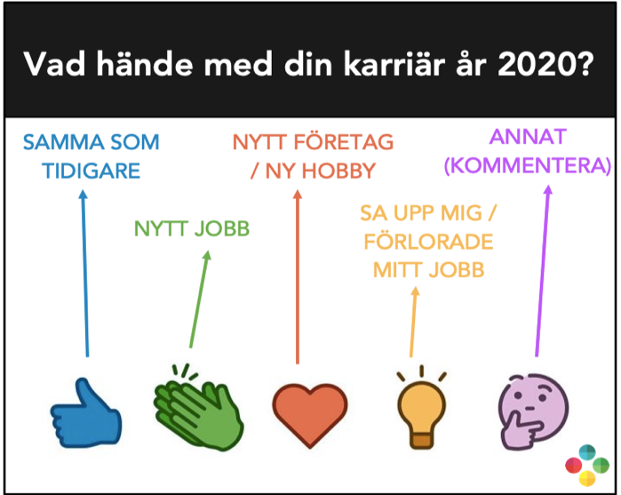
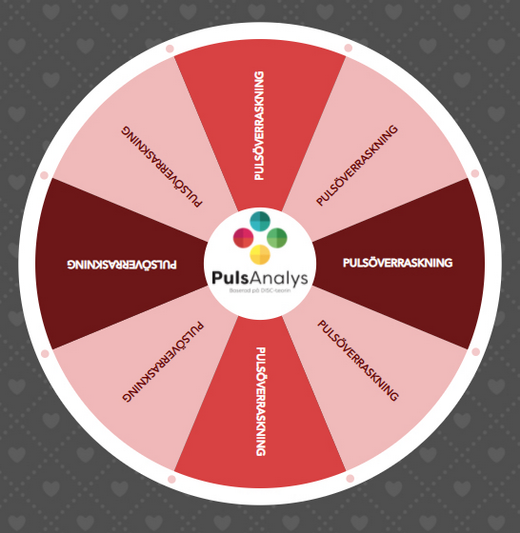

## Den röda personlighetens månad

Vi har nått februari, som inte bara bjuder på kyla och snö i hela vårt avlånga land utan också på kärlekens dag den 14 februari. Därför förknippar vi på PulsAnalys den här månaden lite extra med den röda personligheten.

I det här nyhetsbrevet delar vi med oss av drag som en röd personlighet visar, lite rolig fakta, resultaten av vår Veckans fråga på LinkedIn och en liten nyhet inför alla hjärtans dag.

## En röd person

- Du är den som får saker gjorda.
- Du är den som vågar och är modig, och som ser till att ni snabbt kommer till nästa steg.
- Du gillar utmaningar och att lösa problem.

Känner du igen dig? Då är du kanske en röd person.

Hos en röd person behöver man nästan aldrig tveka om känslorna, för de visas snabbt och tydligt. Röda personer är oftast nyfikna, modiga och vill gärna veta mer om just dig. De vill få saker gjorda och fattar gärna beslut, eftersom de strävar efter resultat. Med andra ord är de oftast drivande, målmedvetna och tar mycket initiativ.

## Resultat av Veckans fråga på LinkedIn

**Veckans fråga 1: Vad hände med din karriär under 2020?**

- 231 personer – samma som tidigare
- 185 personer – nytt jobb
- 46 personer – nytt företag/hobby
- 16 personer – uppsägning
- 6 personer – annat

Totalt deltog 484 personer.

Svaren visar att majoriteten har samma jobb som tidigare, vilket känns positivt. Många har också börjat på ett nytt jobb, och det är glädjande att det faktiskt har anställts en hel del i dessa svåra tider. Tyvärr har en del förlorat jobbet, vilket förstås är tungt. Det man kan göra är att titta på vilka branscher som går bra under pandemin och kanske söka jobb där. Några har startat nytt företag, vilket är modigt. Har man klarat sig med sitt företag under 2020 kan det bara bli bättre.

**Veckans fråga 2: Vilken är din dominerande DISC-färg?**

- 28 personer – pådrivande
- 21 personer – utåtriktad
- 21 personer – lyhörd
- 47 personer – systematisk
- 1 person – vill lära mig mer

Totalt deltog 118 personer.

Det här tycker vi är väldigt intressant! En dominerande andel av de svarande identifierar sig som systematiska (blå). Det stämmer inte så väl med de resultat vi brukar se när vi sammanställer våra övriga analyser, där grön eller gul ofta dominerar inom Sverige. Kanske har de som svarade inte helt förstått frågan, eller Puls-systemet – vem vet?

Bland Mias egna kontakter är andelen röda personer relativt hög. Det kan bero på att hon har fler entreprenörer och företagsledare i sitt kontaktnät än vad som finns bland följarna på vår ordinarie PulsAnalys-sida på LinkedIn.

## Alla hjärtans dag

Vi på PulsAnalys vill sprida lite glädje och kärlek till alla trogna följare med överraskningar som kan delas med nära och kära.

Allt gott önskar teamet på PulsAnalys AB
