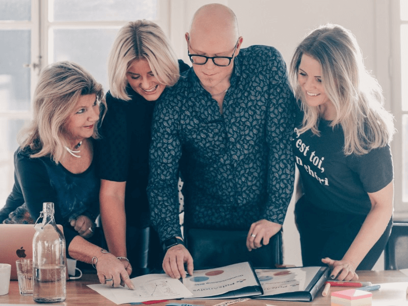
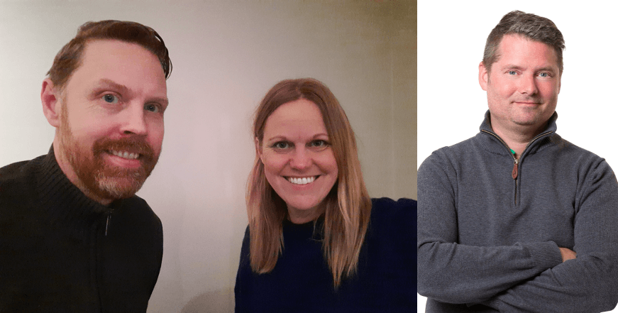
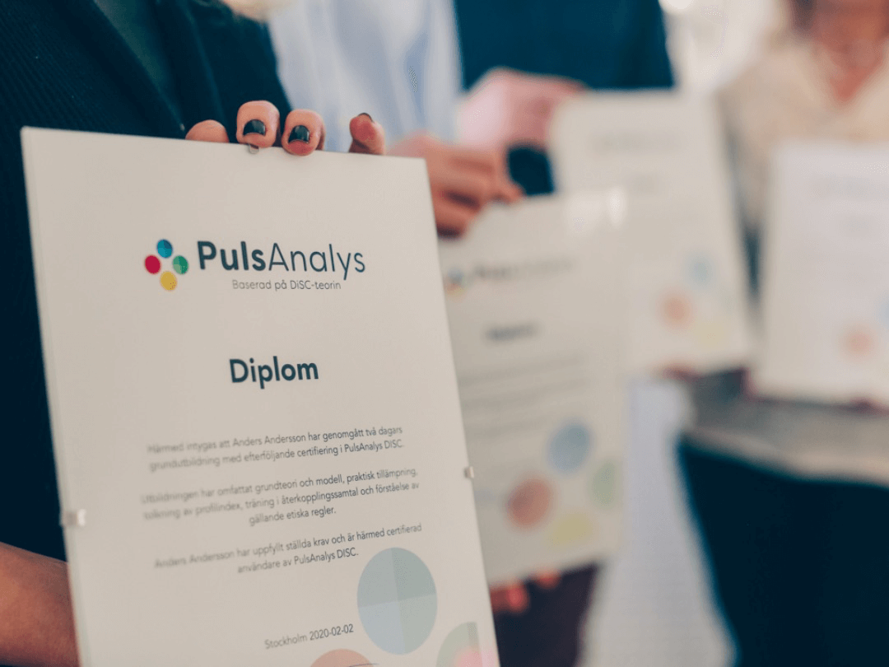
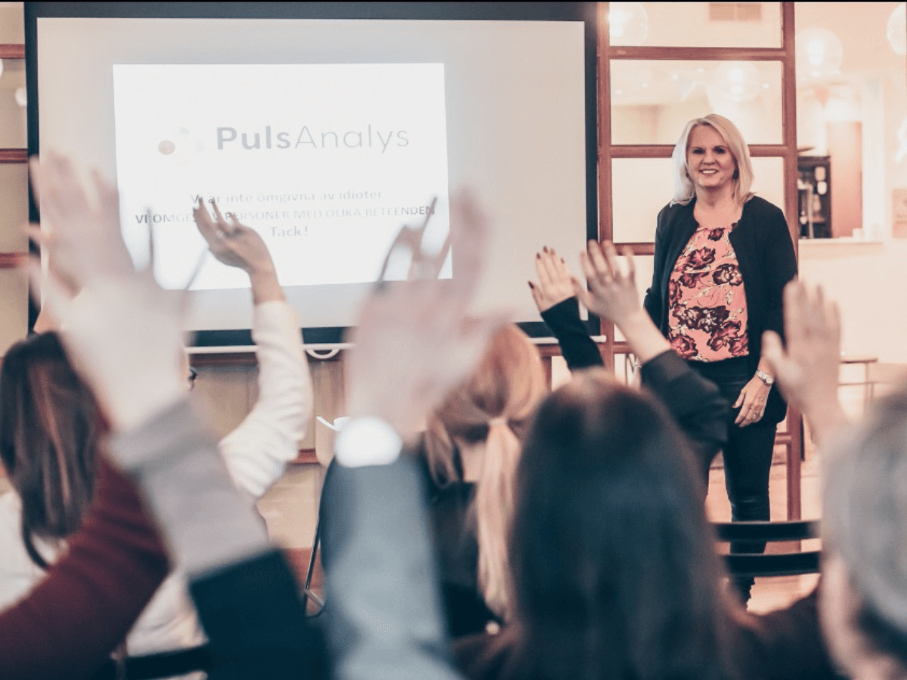
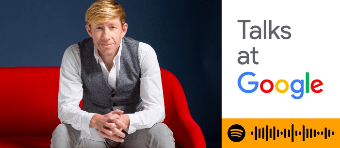

## Nytt år och nya möjligheter

Nere på våra breddgrader av vårt avlånga land har den första snön äntligen kommit. Det blev genast mycket ljusare utanför fönstret, humöret steg och allt kändes lättare. Vi sparkar nu igång vinter- och vårsäsongen, taggade till tusen! Vi hoppas att ni haft en härlig och fridfull julledighet och känner er fulla av energi och redo att dra igång arbetet igen.

I det här nyhetsbrevet delar vi med oss av kommande event, våra planer framöver, en riktigt bra podcastrekommendation och kommande erbjudanden för er som varit oss trogna under året.

## Vann du en Puls-julklapp?

Vi vill påminna dig som deltog i vårt julklappslotteri i december om att använda julklappen du vann. Alla kommande kurser, abonnemang och övrig information hittar du på vår webbplats. Vann du en kostnadsfri profil? Mejla [info@pulsanalys.se](mailto:info@pulsanalys.se) så kontaktar vi dig så snart som möjligt.

Missade du vårt julklappslotteri? Håll utkik på vår webbplats och i sociala medier under våren, så missar du inte kommande överraskningar och tävlingar.

## Kick-offer

Vad sägs om att planera en kick-off på företaget inför årets start? Ett evenemang med både reflektion och många skratt och insikter? Vi på PulsAnalys kan genomföra en kick-off online eller besöka er och hålla föredrag med roliga och lärorika övningar för ditt företag eller din ledningsgrupp.

Kontakta oss på [info@pulsanalys.se](mailto:info@pulsanalys.se) och boka en kick-off för både kropp och knopp inför det nya året.

## Grattis till våra nycertifierade PulsAnalys-användare!

- Malin Nordh – [Malins LinkedIn](https://www.linkedin.com/in/malinnordh/)
- Fredrik Hellström – [Fredriks LinkedIn](https://www.linkedin.com/in/hellstromfredrik/)
- Torbjörn Ohlsson – [Torbjörns LinkedIn](https://www.linkedin.com/in/torbj%C3%B6rn-ohlsson-07528318/)

## Kurser

Grundutbildning och certifiering är det första som krävs för att fullt ut kunna använda verktygen i PulsAnalys. Utbildningen passar chefer, ledare, HR-medarbetare, rekryterare, coacher och konsulter. Vi förmedlar kunskaper om DISC-teorin och om hur man gör återkopplingar, går igenom bakgrund och tolkning av olika profiler och ger exempel på hur du kan använda PulsAnalys i ditt företag.

[Se alla kommande grundutbildningar i DISC](/grundutbildning/).

## Inspirationsföreläsningar

Vi uppdaterar löpande vår webbplats med nya datum för våra inspirationsföreläsningar online om PulsAnalys DISC. Håll utkik och säkra din plats, så missar du inte nya kunskaper och insikter om hur du kan förbättra ditt ledarskap och medarbetarskap. Kommunikation är bland det svåraste som finns, och att bemästra den är en källa till framgång och välbefinnande.

[Se alla kommande föreläsningar](/webbinarier/).

## En nödvändig ögonöppnare inför 2021

Har du lika svårt att vända tillbaka dygnet efter julledigheten som vi? Vi rekommenderar [ett poddavsnitt](https://open.spotify.com/episode/79WIhTLDOPEmDZn1UCDHLB) där professor Matthew Walker berättar om tjugo års forskning om varför sömn spelar roll, hur koffein och alkohol påverkar sömnen och varför våra sömnmönster förändras under livet. Ett samtal som kommer att förändra hur du tänker om läggdags!

Allt gott önskar teamet på PulsAnalys AB
